# Execution Results and Bug Reports

## BUG-01 — Past Matches Displayed and Eligible for Betting

**Severity:** Critical

**Reproduction Steps:**
1. Open the application using the required `user-id` query parameter.
2. Inspect the matches displayed on initial page load.
3. Identify a match whose kickoff date is in the past.
4. Select odds for that match, enter a valid stake, and attempt to place the bet.

**Expected Result:** Only eligible upcoming matches should be available for betting. The application must prevent bets from being placed on past matches.

**Actual Result:** Past matches appear on initial page load, and the application allows bets to be placed on them. Past dates are also selectable in the Date filter.

**Business Impact:** Users may place invalid bets on events that have already occurred, violating a core betting eligibility rule.

**Evidence:** 
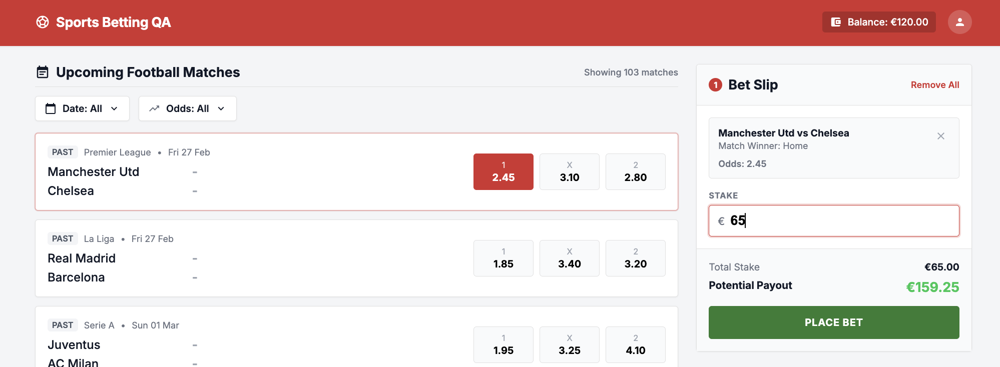
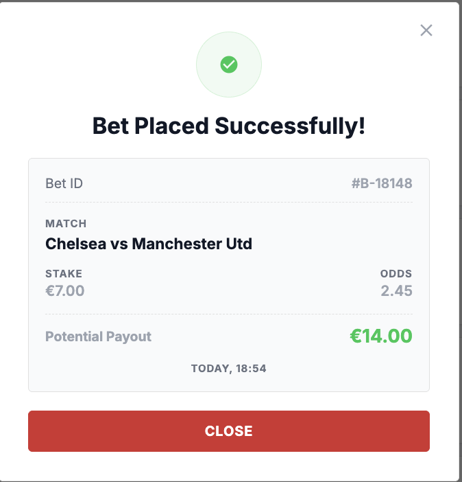

---

## BUG-02 — UI Balance Remains Stale After Successful Bet Placement

**Severity:** Critical

**Reproduction Steps:**
1. Open the application using the required `user-id` query parameter.
2. Place a valid bet and confirm that the success receipt is displayed.
3. Close the receipt without refreshing the page.
4. Attempt to place additional bets whose combined stakes exceed the actual available balance.
5. Retrieve the balance using the API, then refresh the UI and compare the displayed balance.

**Expected Result:** The UI balance updates immediately after a successful bet. The application prevents further bets when the available balance is insufficient.

**Actual Result:** The UI continues to show the previous balance, allowing additional bets to be placed without refreshing. The API confirms that the balance has decreased and can become negative. After refreshing, the UI displays the updated negative balance, and further betting is blocked.

**Business Impact:** Users can submit repeated bets based on a stale balance, potentially resulting in unaffordable bets and negative balances.

**Evidence:** Observed through repeated bet placement without refreshing. API balance checks confirmed that the balance had decreased and eventually become negative.

---

## BUG-03 — API Accepts a Bet Exceeding the Available Balance

**Severity:** Critical

**Reproduction Steps:**
1. Confirm that the user's available balance is €30.00 using the balance API.
2. Submit a `POST /api/place-bet` request with a valid match ID, valid selection, and a stake of €70.00.
3. Inspect the API response and check the available balance again.

**Expected Result:** The API rejects the bet because the stake exceeds the available balance. The bet is not placed, and the balance remains €30.00.

**Actual Result:** The API returns HTTP 200 with a successful bet-placement response and reports a balance of `-40`.

**Business Impact:** The API accepts an unaffordable bet and permits the account balance to become negative, compromising financial transaction integrity.

**Evidence:** 
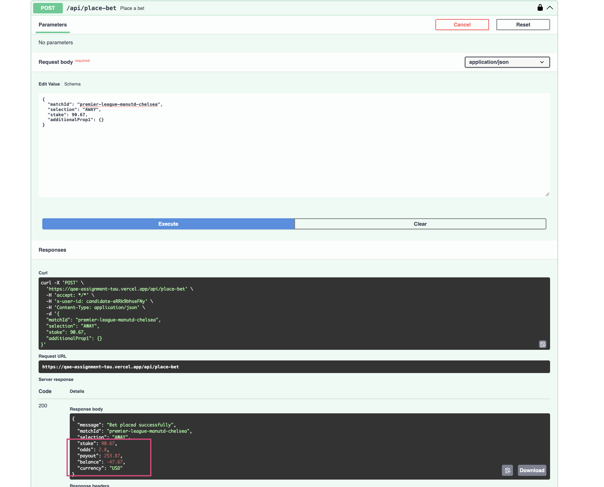

---

## BUG-04 — Invalid Odds Range Is Accepted Without Validation

**Severity:** High

**Reproduction Steps:**
1. Open the application using the required `user-id` query parameter.
2. Open the Odds filter.
3. Enter a minimum odds value greater than the maximum odds value in text fields or drag the range.
4. Click Apply.

**Expected Result:** The application rejects the invalid odds range and displays clear validation feedback.

**Actual Result:** The application applies the invalid range without displaying a validation error.

**Business Impact:** Users may receive misleading or unexpected results when applying an invalid odds range.

**Evidence:**
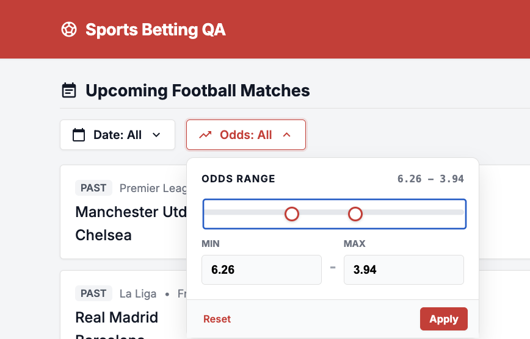

---

## BUG-05 — Incorrect Potential Payout Displayed in Success Receipt

**Severity:** High

**Reproduction Steps:**
1. Open the application using the required `user-id` query parameter.
2. Select a match with odds of 2.45.
3. Enter a stake of €10.00.
4. Confirm the potential payout displayed in the Bet Slip.
5. Place the bet and inspect the success receipt.

**Expected Result:** The success receipt displays the correct potential payout of €24.50, calculated as stake × odds.

**Actual Result:** The Bet Slip correctly displays a potential payout of €24.50, but the success receipt displays €20.00.

**Business Impact:** Incorrect payout information may mislead users about their potential winnings and reduce trust in bet confirmations.

**Evidence:** Screenshots show €24.50 in the Bet Slip and €20.00 in the success receipt for the same bet.
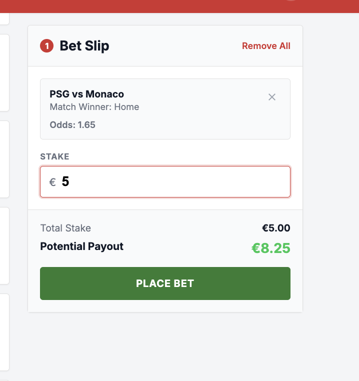
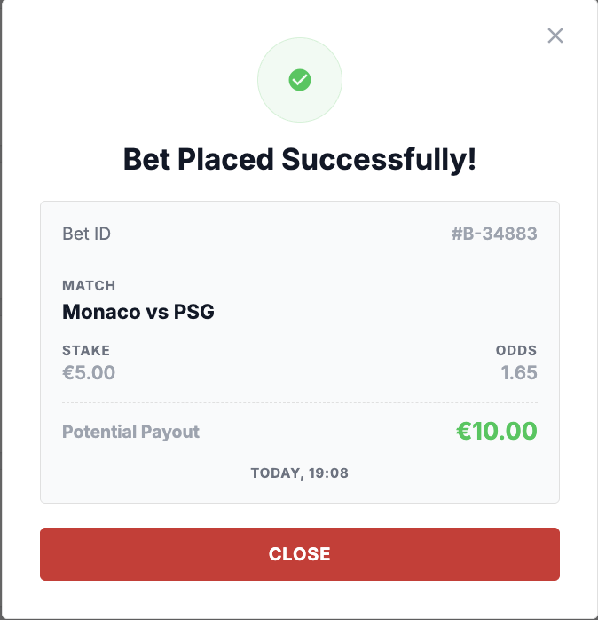

---

## BUG-06 — Bet-Placement API Returns Incorrect Currency

**Severity:** High

**Reproduction Steps:**
1. Open the API documentation.
2. Submit a valid `POST /api/place-bet` request using the required `x-user-id` header and a valid request body.
3. Inspect the currency field in the response.

**Expected Result:** The API response identifies the currency as `EUR`, consistent with the assignment's specified currency.

**Actual Result:** The API response contains `"currency": "USD"`.

**Business Impact:** Incorrect currency information may mislead API consumers and cause confusion when interpreting financial amounts.

**Evidence:** Swagger response screenshot showing `"currency": "USD"` in the successful bet-placement response.

---

## BUG-07 — Odds Filter Displays Results Outside the Selected Range

**Severity:** High

**Reproduction Steps:**
1. Open the application using the required `user-id` query parameter.
2. Open the Odds filter and set the minimum odds to `1` and maximum odds to `3`.
3. Click Apply.
4. Inspect the odds displayed for the filtered matches across the Home, Draw, and Away selections.

**Expected Result:** The filtered results contain only odds within the inclusive range of `1.00` to `3.00`.

**Actual Result:** The filtered results include odds outside the selected range, including values such as `3.5` and `3.6`.

**Business Impact:** Users may see betting options that do not satisfy their selected criteria, making the filter unreliable.

**Evidence:**
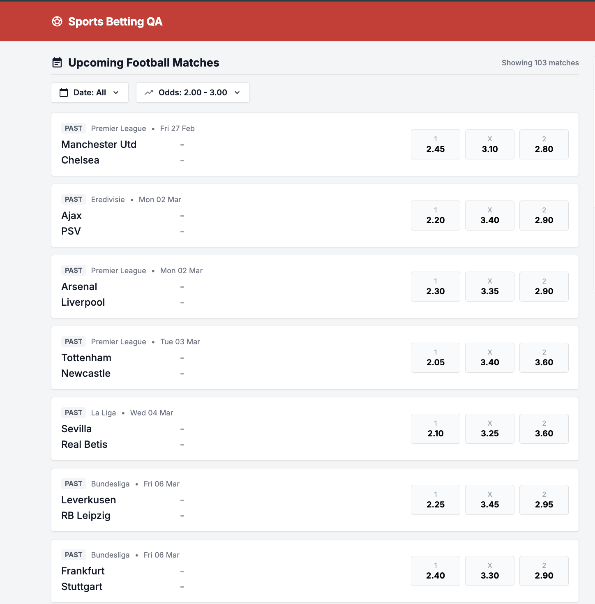

---

## BUG-8 — Balance Reset API Returns an Inconsistent Balance

**Severity:** High

**Reproduction Steps:**
1. Call `POST /api/reset-balance` using the required `x-user-id` header.
2. Inspect the HTTP response and the returned balance.
3. Call `GET /api/balance` for the same user or refresh the UI.
4. Compare the returned balance with the balance reported by the reset API.

**Expected Result:** The balance reported by the reset API matches the persisted balance returned by the balance API and displayed in the UI after the reset.

**Actual Result:** The reset API returns HTTP 200 and reports a balance of €125.50, but the subsequent balance API response or refreshed UI shows €120.00.

**Business Impact:** Inconsistent balance information may mislead users and make it difficult to determine the correct amount available for betting.

**Evidence:** Observed through the reset API response and a subsequent balance check.
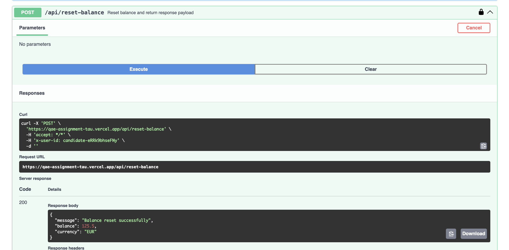
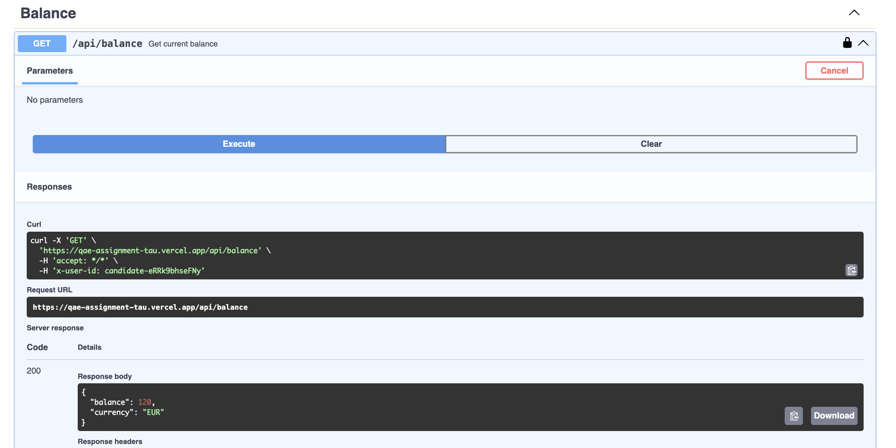
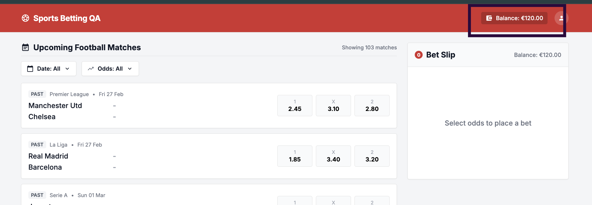

---

## BUG-9 — Selection Missing from Success Receipt

**Severity:** Medium

**Reproduction Steps:**
1. Open the application using the required `user-id` query parameter.
2. Select a match outcome (Home, Draw, or Away) and place a valid bet.
3. Inspect the details displayed in the success receipt.

**Expected Result:** The success receipt displays the selected outcome (Home, Draw, or Away), along with the other required bet details.

**Actual Result:** The success receipt displays the Bet ID, match details, stake, odds, and potential payout, but does not display the selected outcome.

**Business Impact:** Users cannot confirm which outcome they placed their bet on, making the receipt incomplete and potentially causing confusion about the transaction.

**Evidence:** Success receipt screenshot showing the available fields but no selection.

---

## BUG-10 — Match Count Does Not Update After Applying Filters

**Severity:** Medium

**Reproduction Steps:**
1. Open the application using the required `user-id` query parameter.
2. Apply a Date or Odds filter that returns fewer matches than the initial list.
3. Compare the number of matches displayed with the match count shown above the results.

**Expected Result:** The displayed match count should accurately reflect the filtered results if the counter represents the number of matches currently displayed.

**Actual Result:** The counter continues to show approximately 103 matches even when only a small number of matches, such as two, are displayed.

**Business Impact:** Users may be misled about the number of matches available after filtering.

**Evidence:** 
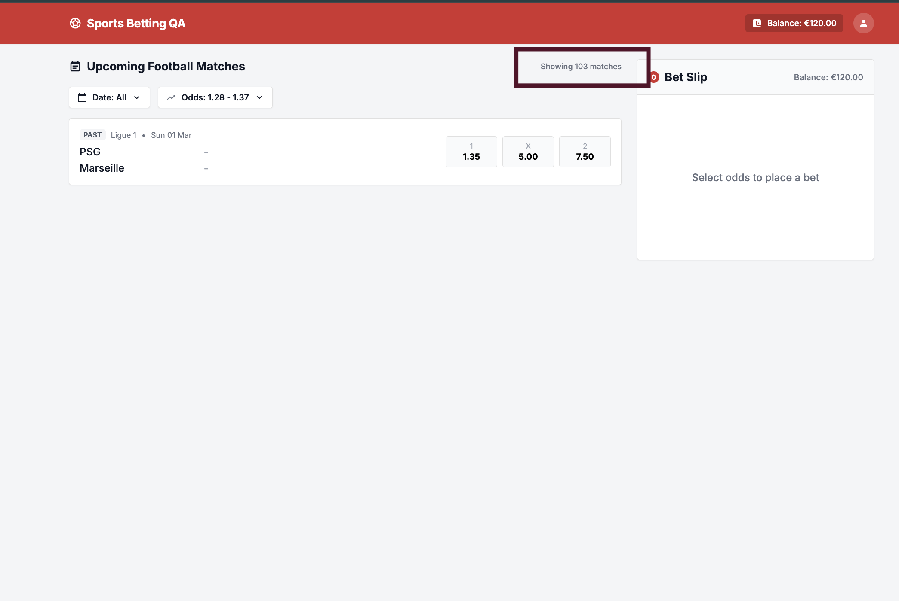

---

## BUG-11 — Home and Away Teams Reversed in Success Receipt

**Severity:** Medium

**Reproduction Steps:**
1. Open the application using the required `user-id` query parameter.
2. Select odds for a match and inspect the home and away team order in the Bet Slip.
3. Place the bet successfully.
4. Compare the match order shown in the success receipt with the Bet Slip.

**Expected Result:** The success receipt displays the teams in the same correct home-versus-away order as the selected match in the Bet Slip.

**Actual Result:** The success receipt reverses the team order, displaying the away team before the home team.

**Business Impact:** Users may be confused about which match their bet was placed on, reducing confidence in the transaction receipt.

**Evidence:** Success receipt screenshot showing the reversed team order compared with the Bet Slip.
